# Самостоятельная работа 3. Определение целевой аудитории

**Проект:** «Сервис рекомендации книг»
**Группа:** 5
**Дата:** 20.10.2026

---

## 1. Цель и исходные данные

**Цель работы** — понять, для кого создаётся сервис рекомендации книг, какие у этих людей потребности и проблемы, и как это должно повлиять на функции и оформление продукта.

**Исходные данные.** Для анализа мы провели онлайн-опрос из 14 вопросов (возраст, род деятельности, привычки чтения, источники знакомства с книгами, трудности выбора, ожидания от сервиса). В опросе приняли участие **13 респондентов**. Таблица ответов и диаграммы по каждому вопросу находятся в файле [`results.xlsx`](assets/results.xlsx) (лист «Ответы» — все ответы, лист «Диаграммы» — диаграммы).

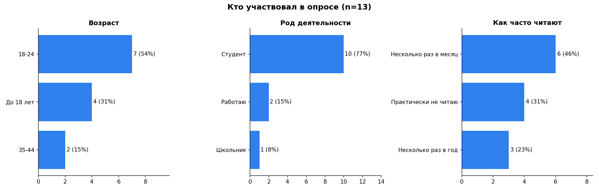

Состав респондентов: 7 человек (54%) в возрасте 18–24 лет, 4 (31%) — до 18 лет, 2 (15%) — 35–44 лет. По роду деятельности: 10 студентов, 1 школьник, 2 работающих.

**Ограничения данных** (важно учитывать при выводах):

- Выборка маленькая (13 человек), поэтому проценты показывают тенденции, а не статистику. В тексте мы всегда указываем и долю, и число человек.
- Выборка смещена к молодёжи: 11 из 13 респондентов моложе 25 лет. Старшие возрастные группы (25–34, 45+) в опросе не представлены.
- Два ответа от респондентов 35–44 лет совпадают полностью и отправлены с разницей около 17 секунд. Возможно, это один человек или дубль, поэтому сегмент C мы считаем гипотезой, которую нужно проверить.
- Один респондент (до 18 лет) выбрал противоречивые варианты (например, одновременно «Не читаю» и все остальные форматы, «Хз»). Его ответы учтены в общих подсчётах, но на выводы по сегменту они почти не влияют.
- В опросе не было прямого вопроса об уровне владения техникой. Поэтому уровень оценён **косвенно**: по формату чтения (электронные книги, аудио), источникам информации (соцсети, приложения), опыту использования сервисов и предпочтению мобильного приложения.

---

## 2. Как выделялись сегменты

Мы разделили респондентов по двум признакам, которые сильнее всего различают их поведение в опросе:

1. **Возраст и род деятельности** (школьники и студенты — работающие взрослые).
2. **Частота чтения** («несколько раз в месяц» — «несколько раз в год» или «практически не читаю»).

Правила отнесения:

| Сегмент | Правило | Респондентов |
|---|---|---|
| **A. Молодой увлечённый читатель** | до 24 лет и читает несколько раз в месяц | 6 (46%) |
| **B. Студент-эпизодический читатель** | до 24 лет и читает несколько раз в год или почти не читает | 5 (38%) |
| **C. Занятой взрослый читатель** | 35–44 года, работает | 2 (15%) |

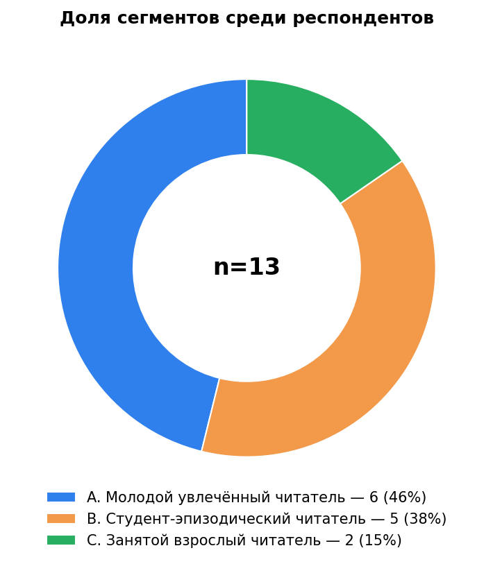

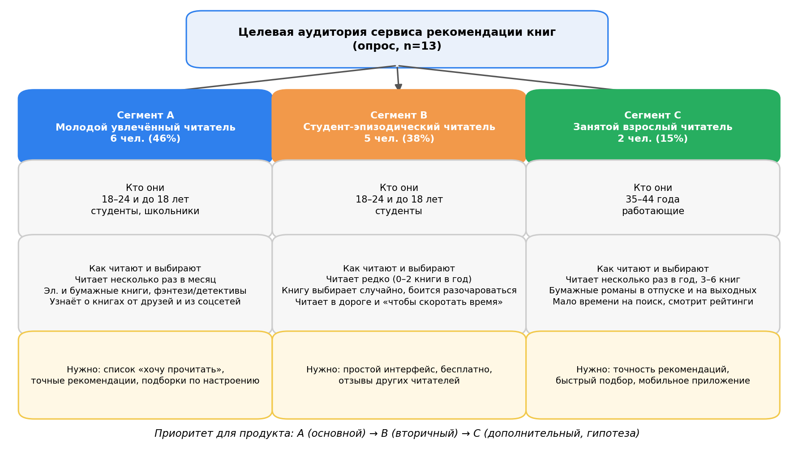

---

## 3. Перечень сегментов с обоснованием

### Сегмент A. Молодой увлечённый читатель (основной)

**Кто это:** школьники и студенты до 24 лет (4 человека 18–24 лет и 2 до 18 лет), которые читают несколько раз в месяц.

**Обоснование:**

- Это самая большая группа (6 из 13) и самая вовлечённая: у них самый регулярный контакт с книгами, а значит, больше всего поводов пользоваться сервисом.
- Они активно ищут новые книги: 4 из 6 узнают о них от друзей и 4 из 6 из соцсетей и от блогеров.
- У них самый чёткий запрос к сервису: 5 из 6 хотят вести список «хочу прочитать», 4 из 6 важна точность рекомендаций, 3 из 6 нужны подборки по настроению или теме.
- 4 из 6 предпочитают мобильное приложение.
- Самые популярные жанры: фантастика и фэнтези (5 из 6), детективы (4 из 6).

### Сегмент B. Студент-эпизодический читатель (вторичный)

**Кто это:** студенты до 24 лет (3 человека 18–24 лет и 2 до 18 лет), которые читают несколько раз в год или почти не читают (все 5 отметили 0–2 книги в год).

**Обоснование:**

- Это почти столько же людей, сколько в сегменте A (5 из 13), и это **потенциальный рост**: сервис может помочь им начать читать чаще.
- Они чаще выбирают книгу случайно, по обложке или названию (3 из 5), то есть у них нет устойчивой привычки искать и выбирать книги.
- Читают они, чтобы скоротать время (4 из 5), в основном в дороге и на отдыхе (по 3 из 5).
- Для них критичны низкий порог входа и цена: 4 из 5 важен простой интерфейс, 3 из 5 важна бесплатность.
- Они осторожны при выборе: 2 из 5 боятся разочароваться и потратить деньги или время впустую, у 2 из 5 рекомендации не совпадали со вкусами.

### Сегмент C. Занятой взрослый читатель (дополнительный, гипотеза)

**Кто это:** работающие люди 35–44 лет, читают несколько раз в год (3–6 книг).

**Обоснование:**

- Это отдельная по контексту группа: взрослые с ограниченным временем, читают бумажные книги в отпуске и на выходных.
- Оба респондента назвали главной трудностью нехватку времени на поиск, а главным в сервисе — точность рекомендаций.
- Оба уже пробовали сервисы рекомендаций несколько раз, то есть знакомы с категорией продукта.
- Группа маленькая (2 человека), возможно, это дубль ответов, поэтому её выводы нужно подтвердить дополнительным опросом.

---

## 4. Таблица характеристик сегментов

В скобках указано число человек в сегменте, выбравших вариант.

| Характеристика | A. Молодой увлечённый читатель (n=6) | B. Студент-эпизодический читатель (n=5) | C. Занятой взрослый читатель (n=2) |
|---|---|---|---|
| **Доля респондентов** | 46% | 38% | 15% |
| **Возраст** | 18–24 (4), до 18 (2) | 18–24 (3), до 18 (2) | 35–44 (2) |
| **Род деятельности** | студенты (5), школьник (1) | студенты (5) | работающие (2) |
| **Частота чтения** | несколько раз в месяц (6) | почти не читают (4), несколько раз в год (1) | несколько раз в год (2) |
| **Книг в год** | 3–6 (4), 0–2 (2) | 0–2 (5) | 3–6 (2) |
| **Формат чтения** | бумажные (3), электронные (3), аудио (1) | бумажные (3), аудио (3), электронные (2) | бумажные (2) |
| **Когда читают** | на отдыхе (3), в выходные и отпуске (3), перед сном (2), в перерывах (2) | на отдыхе (3), в дороге (3), перед сном (2) | в выходные и отпуске (2) |
| **Цель чтения** | удовольствие (4), саморазвитие (3), учёба или работа (2) | скоротать время (4), учёба или работа (2), удовольствие (2), саморазвитие (2) | удовольствие (2) |
| **Как узнают о книгах** | друзья (4), соцсети и блогеры (4), рейтинги на сайтах (2) | случайно, по обложке или названию (3), друзья (2), рейтинги (2), рекомендации в приложениях (2) | рейтинги и подборки на сайтах (2) |
| **Любимые жанры** | фантастика и фэнтези (5), детективы (4) | фантастика и фэнтези (4), бизнес и саморазвитие (3), учебная литература (3) | романы (2) |
| **Проблемы при выборе** | не знают, что подойдёт (2), сложно найти нужную тематику (2); «трудностей нет» (2) | не совпадают вкусы (2), страх разочароваться (2), сложно найти нужную тематику (2); «трудностей нет» (3) | мало времени на поиск (2) |
| **Опыт с сервисами рекомендаций** | слышали, но не пользовались (3), пробовал (1), регулярно (1), не знали (1) | не знали (2), пробовали (2), регулярно (1) | пробовали несколько раз (2) |
| **Что важно в сервисе** | список «хочу прочитать» (5), точность (4), подборки по настроению (3) | простой интерфейс (4), бесплатность (3), отзывы (3), список «хочу прочитать» (3) | точность рекомендаций (2) |
| **Как удобнее пользоваться** | приложение (4), сайт (1), без разницы (1) | приложение (3), без разницы (2) | приложение (2) |
| **Уровень владения техникой (косвенно)** | высокий: электронные книги, соцсети, приложения | средний или высокий: смартфон, аудиокниги, не привязаны к формату сервиса | средний: бумажные книги, но уже пользовались сервисами |
| **Главные потребности** | вести свои списки, получать точные рекомендации, находить книги по настроению | быстро и без риска выбрать интересную книгу, без платы и сложных шагов | быстро найти подходящий роман, не тратя время на поиск |

### Сравнение сегментов по запросам к сервису

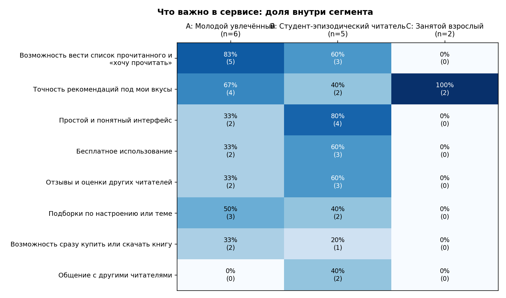

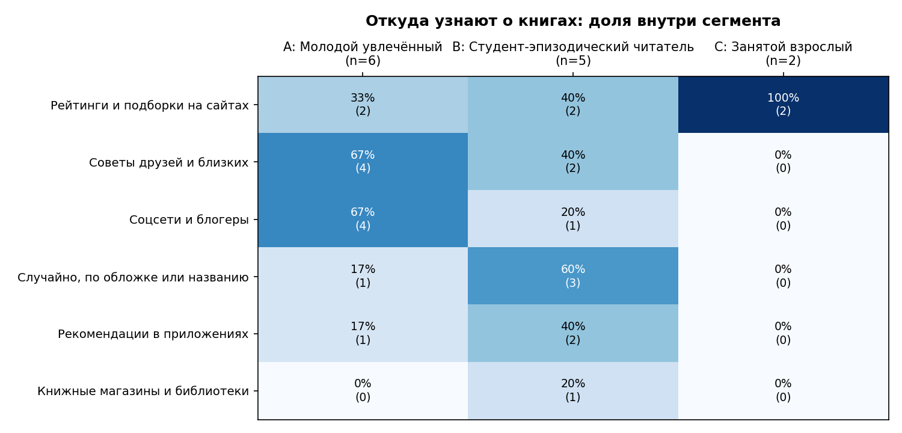

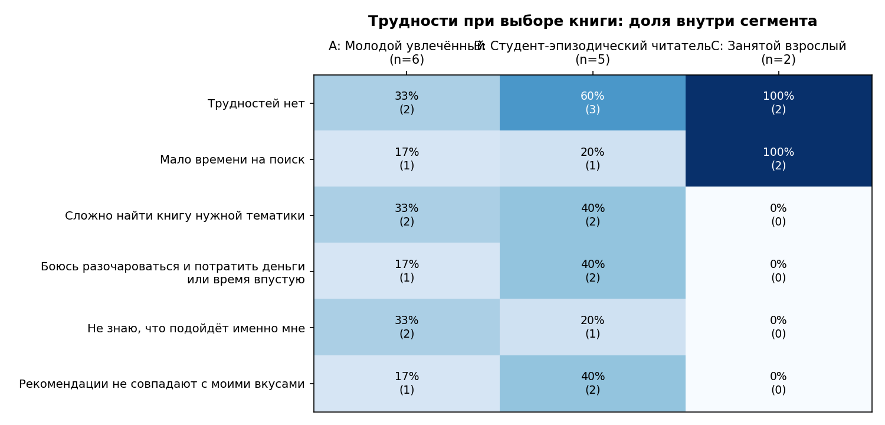

Общая картина по всем респондентам:

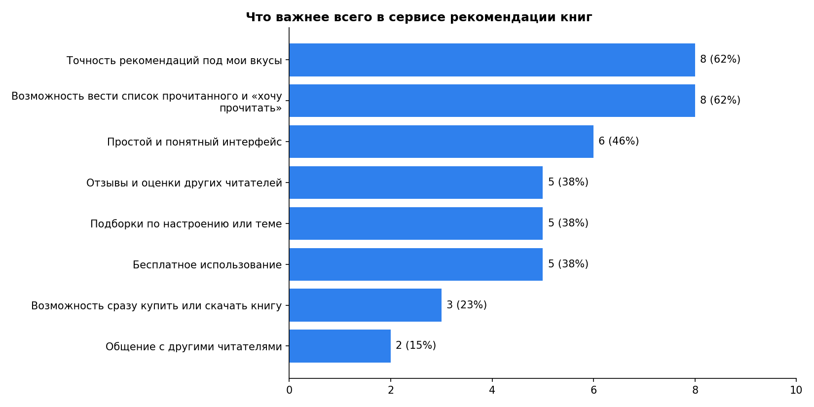

---

## 5. Портреты пользователей

Портреты собирательные: они построены на ответах респондентов своего сегмента.

### Портрет 1. Алина, 19 лет (сегмент A)

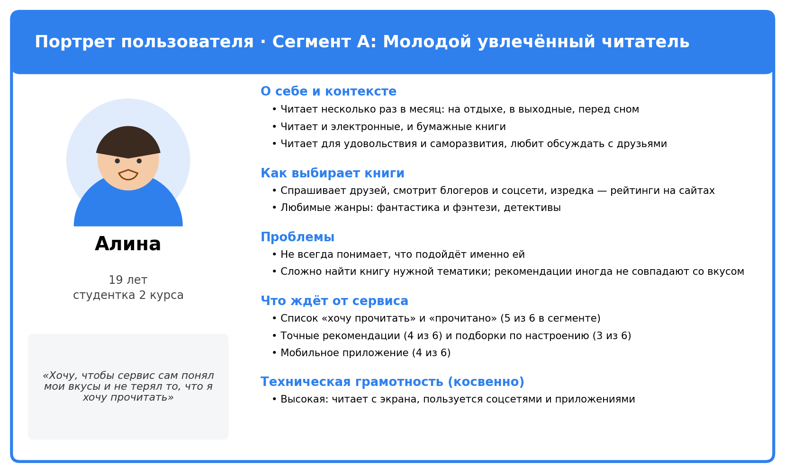

### Портрет 2. Данил, 20 лет (сегмент B)

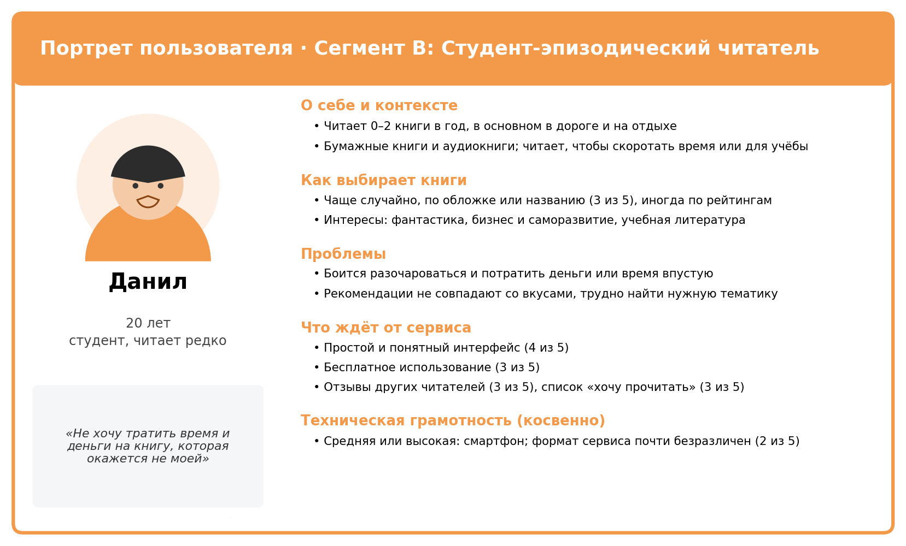

### Портрет 3. Марина, 38 лет (сегмент C)

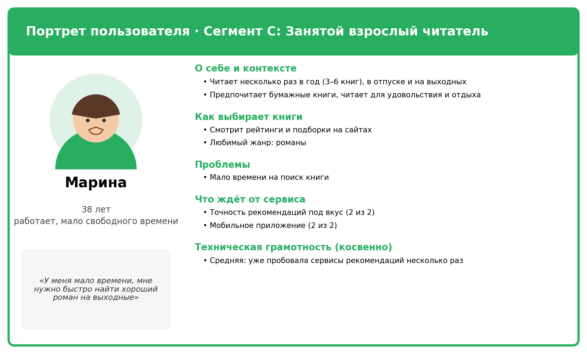

---

## 6. Единое видение целевой аудитории в команде

_Формулировка для согласования внутри команды. После обсуждения впишите дату и состав участников._

**Для кого мы делаем сервис.** Наш сервис рекомендации книг создаётся в первую очередь для **молодых читателей: школьников и студентов до 24 лет**, которые читают регулярно и хотят легко находить новые книги по своим вкусам и не терять найденное. Во вторую очередь — для студентов, которые читают редко и которых нужно «зацепить» простотой и бесплатностью. Занятые взрослые — дополнительная аудитория, проверим её отдельно.

**О чём мы договорились:**

1. Основной сегмент — **A (молодой увлечённый читатель)**; под него проектируем ядро продукта.
2. Вторичный сегмент — **B (эпизодический читатель)**; под него делаем простой вход и бесплатную базовую версию.
3. Сегмент **C** учитываем как гипотезу и проверяем дополнительным опросом взрослых 25+.
4. Основной формат — **мобильное приложение** (9 из 13 респондентов), веб-версия вторична.
5. Главные ценности продукта: **точные рекомендации**, **личные списки книг**, **простой интерфейс**, **бесплатный доступ к базовым функциям**.

| Участник команды | Согласие с формулировкой |
|---|---|
| _(ФИО)_ | _(да / нет, дата)_ |
| _(ФИО)_ | _(да / нет, дата)_ |

---

## 7. Вывод: как особенности аудитории повлияют на продукт

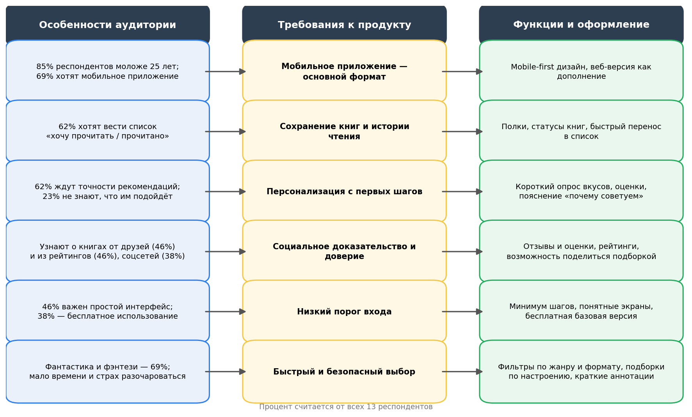

**Главные выводы:**

1. **Аудитория молодая и мобильная.** 11 из 13 респондентов моложе 25 лет, 9 из 13 хотят мобильное приложение. Значит, интерфейс нужно проектировать сначала для смартфона, с короткими экранами и минимумом текста. Веб-версия — дополнение.
2. **Людям важно не терять найденное.** 8 из 13 (62%) назвали важной возможность вести список «хочу прочитать» и «прочитано». В основной сегмент A этого хотят 5 из 6. Список книг должен быть в ядре продукта, а не в отдельном разделе «на потом».
3. **Главное ожидание — точность.** 8 из 13 (62%) важны рекомендации под их вкусы, а 3 из 13 не знают, что им подойдёт, и ещё 3 сталкивались с несовпадением рекомендаций со вкусом. Поэтому нужен короткий стартовый опрос вкусов (жанры, любимые книги), оценка прочитанного и пояснение «почему мы это советуем».
4. **Доверие строится на мнении других.** О книгах узнают от друзей (6 из 13), из рейтингов (6 из 13) и из соцсетей (5 из 13). Значит, нужны отзывы и оценки читателей, рейтинги и возможность поделиться подборкой.
5. **Низкий порог входа.** Для 6 из 13 важен простой интерфейс, для 5 из 13 — бесплатность, а в сегменте B это 4 из 5 и 3 из 5. Регистрация, онбординг и первые рекомендации должны занимать минимум шагов, базовые функции — бесплатные.
6. **Сам выбор книги большинство не считает проблемой.** 10 из 13 ответили «совсем не сложно» или «скорее не сложно», а 7 из 13 отметили вариант «Трудностей нет». Поэтому сервис нельзя продавать как «решение боли выбора». Его ценность в удобстве: точные подборки, личные списки, экономия времени, снижение риска разочароваться (сегменты B и C).
7. **Контент.** Самые популярные жанры — фантастика и фэнтези (9 из 13), романы (6 из 13), бизнес и саморазвитие (5 из 13), детективы (5 из 13). Эти жанры нужно покрыть в каталоге и подборках в первую очередь. Фильтры по формату (бумажные, электронные, аудио) пригодятся, потому что аудитория читает в разных форматах.
8. **Что можно отложить.** Покупка или скачивание книги внутри сервиса важны для 3 из 13, общение с другими читателями — для 2 из 13. Эти функции стоит делать после ядра.

**Приоритет функций (предложение для MVP):**

| Приоритет | Функции |
|---|---|
| Обязательно | мобильное приложение, стартовый опрос вкусов, персональные рекомендации, списки «хочу прочитать» и «прочитано», отзывы и оценки, простой интерфейс, бесплатная базовая версия |
| Желательно | подборки по настроению и теме, фильтры по жанру и формату, функция «поделиться подборкой», краткие аннотации |
| Позже | покупка или скачивание книги, общение с другими читателями, расширенная веб-версия |

**Что нужно проверить дальше:** провести дополнительный опрос с большим числом участников (особенно 25+), прямо спросить об уровне владения техникой и готовности платить, а также проверить на нескольких пользователях сегмента A прототип стартового опроса вкусов.

---

## 8. Ответы на контрольные вопросы

**1. Что такое целевая аудитория?**
Это группа людей, для которых создаётся продукт и у которых есть общие потребности, привычки и проблемы, которые продукт должен решать. В нашем проекте это читатели, которым нужно находить интересные книги и вести списки.

**2. Зачем описывать целевую аудиторию до проектирования продукта?**
Чтобы команда одинаково понимала, для кого она делает продукт, и принимала решения о функциях и интерфейсе на основе реальных потребностей, а не личных предпочтений. Так снижается риск потратить время на функции, которые никому не нужны. Например, опрос показал, что общение между читателями важно лишь 2 из 13, а списки книг — 8 из 13.

**3. Что такое сегментация пользователей?**
Это разделение всех пользователей на группы с похожими характеристиками и поведением (возраст, занятие, частота использования, мотивы). Сегментация помогает понять, что общего у людей в группе и чем группы отличаются. Мы разделили респондентов по возрасту, роду деятельности и частоте чтения на три сегмента.

**4. Что такое «портрет пользователя»?**
Это собирательный образ типичного представителя сегмента: имя, возраст, занятие, привычки, цели, проблемы и ожидания от продукта. Он делает аудиторию «живой» и помогает команде представлять конкретного человека при проектировании. Наши портреты — Алина, Данил и Марина.

**5. Как целевая аудитория влияет на функции и оформление продукта?**
От аудитории зависят и набор функций, и внешний вид, и тон общения. Наша аудитория молодая и пользуется смартфоном, поэтому мы проектируем мобильное приложение с простым интерфейсом. Так как пользователи ценят списки книг и точные рекомендации, эти функции войдут в ядро. А поскольку доверяют друзьям, отзывам и рейтингам, мы добавим отзывы и возможность делиться подборками.
