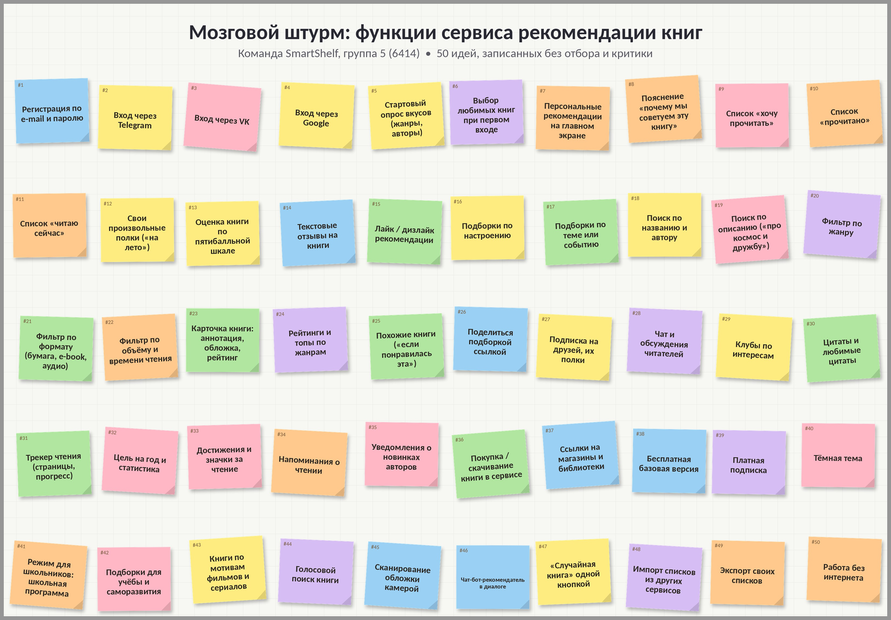
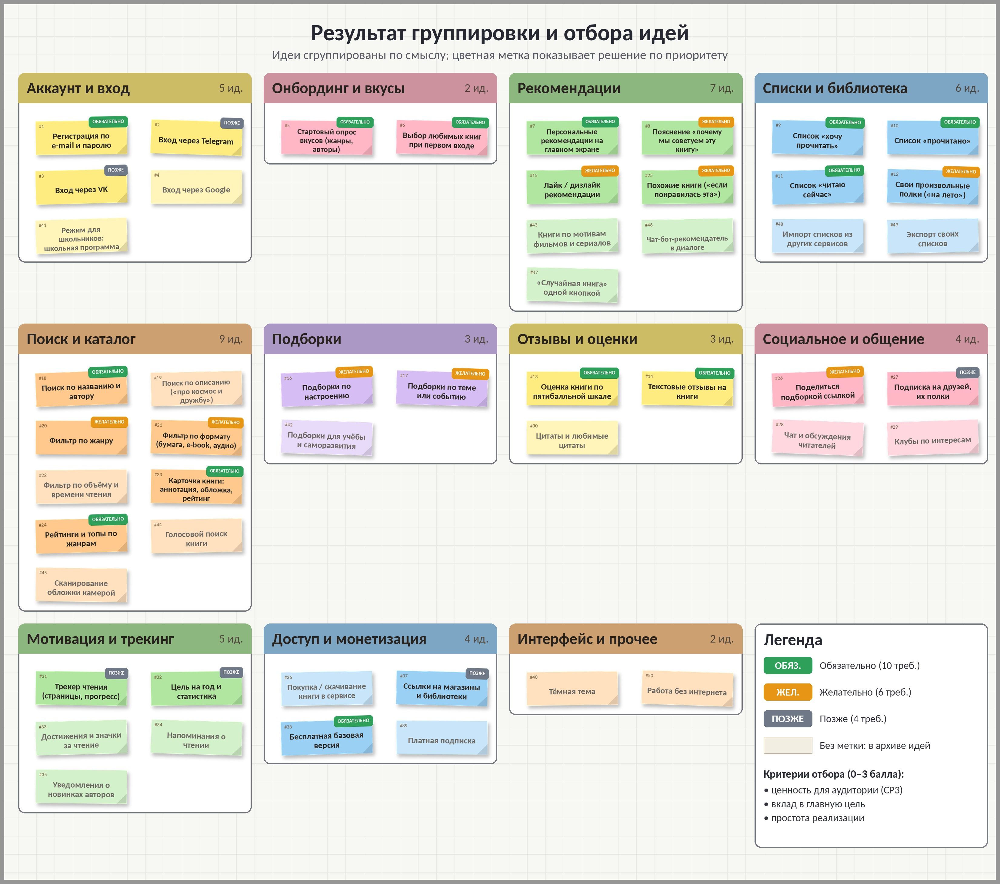

# Самостоятельная работа 4. Выявление функциональных требований методом мозгового штурма

**Проект:** «Сервис рекомендации книг» (команда SmartShelf)
**Группа:** 5, 6414
**Дата:** ДД.ММ.2026

---

## 1. Цель и исходные данные

**Цель работы** — сформировать навыки выявления функций будущего продукта с помощью командного метода мозгового штурма.

**Исходные данные.** Штурм опирался на результаты самостоятельной работы 3 (опрос 13 респондентов, три сегмента аудитории). Главные выводы, которые команда держала перед глазами:

- основной сегмент — молодые читатели до 24 лет (A), вторичный — эпизодические читатели-студенты (B), сегмент C (занятые взрослые) — гипотеза;
- 9 из 13 хотят мобильное приложение;
- 8 из 13 важны списки «хочу прочитать» / «прочитано», 8 из 13 — точность рекомендаций;
- 6 из 13 важен простой интерфейс, 5 из 13 — бесплатность;
- о книгах узнают от друзей (6 из 13), из рейтингов (6 из 13) и соцсетей (5 из 13);
- общение между читателями важно лишь 2 из 13, покупка или скачивание книги — 3 из 13.

---

## 2. Проведение мозгового штурма

| Параметр | Значение |
|---|---|
| **Формат** | очная встреча команды, общая доска (бумажная / онлайн) |
| **Дата и место** | ДД.ММ.2026, указать место или платформу |
| **Участники** | все 5 человек: руководитель разработки/дизайнер (Черноусиков С.А.), архитектор ПО (Соломатин А.А.), программист (Чуриков А.О.), специалист по тестированию (Черничкин И.А.), менеджер проекта (Степанова О.А.) |
| **Ведущий** | менеджер проекта |
| **Секретарь** | специалист по тестированию (фиксирует идеи на доске) |
| **Длительность** | около 60 минут, указать фактическое время |

**Этапы:**

1. **Постановка задачи (5 мин).** Ведущий напомнил цель и вывод СР3: что нужно аудитории.
2. **Генерация идей (15 мин).** Каждый предлагает функции вслух и записывает их на стикеры. Критика запрещена.
3. **Фиксация (5 мин).** Секретарь переносит все идеи на общую доску и нумерует.
4. **Группировка (15 мин).** Похожие идеи объединяются в группы.
5. **Отбор (15 мин).** Идеи оцениваются по критериям и делятся на «обязательно / желательно / позже».
6. **Формулировка требований (5 мин).** Отобранные идеи переписаны в виде функциональных требований.

**Правила штурма:**

1. **Критика запрещена** во время генерации: ни «это нереально», ни «это не нужно».
2. **Количество важнее качества:** чем больше идей, тем лучше.
3. **Приветствуются необычные идеи**, в том числе шуточные.
4. **Развиваем чужие идеи:** можно дополнять и комбинировать.
5. **Фиксируется всё**, без отбора.
6. **Говорит один человек**, остальные слушают.

*(Вставить фото или скриншот доски со стикерами.)*

---

## 3. Полный список сгенерированных идей

Все идеи записаны без отбора, в порядке появления.

1. Регистрация по e-mail и паролю
2. Вход через Telegram
3. Вход через VK
4. Вход через Google
5. Стартовый опрос вкусов (жанры, любимые авторы)
6. Выбор любимых книг при первом входе
7. Персональные рекомендации на главном экране
8. Пояснение «почему мы советуем эту книгу»
9. Список «хочу прочитать»
10. Список «прочитано»
11. Список «читаю сейчас»
12. Свои произвольные списки и полки (например, «на лето»)
13. Оценка книги по пятибалльной шкале
14. Текстовые отзывы на книги
15. Лайки и дизлайки рекомендаций («не показывать такое»)
16. Подборки по настроению
17. Подборки по теме или событию (экзамены, отпуск, зима)
18. Поиск по названию и автору
19. Поиск по описанию («книга про космос и дружбу»)
20. Фильтры по жанру
21. Фильтры по формату (бумажная, электронная, аудио)
22. Фильтры по объёму и времени чтения
23. Карточка книги с аннотацией, обложкой и рейтингом
24. Рейтинги и топы по жанрам
25. Похожие книги («если понравилась эта»)
26. Поделиться подборкой или книгой ссылкой
27. Подписка на друзей и просмотр их полок
28. Чат или обсуждения между читателями
29. Клубы по интересам
30. Цитаты из книг и сохранение любимых цитат
31. Трекер чтения (страницы, прогресс)
32. Цель на год («прочитать 12 книг») и статистика
33. Достижения и значки за чтение
34. Напоминания о чтении
35. Уведомления о новинках любимых авторов
36. Скачивание или покупка книги внутри сервиса
37. Ссылки на магазины и библиотеки, где книга есть
38. Бесплатная базовая версия
39. Платная подписка с расширенными функциями
40. Тёмная тема
41. Режим для школьников: школьная программа, литература для чтения
42. Подборки для учёбы и саморазвития
43. Рекомендации по фильмам и сериалам, по которым есть книги
44. Голосовой поиск книги
45. Сканирование обложки камерой, чтобы найти книгу
46. Рекомендации от чат-бота в диалоге
47. «Случайная книга» одной кнопкой
48. Импорт списков из других сервисов
49. Экспорт своих списков
50. Работа без интернета

---

## 4. Группировка и отбор идей

### 4.1. Группы идей

| Группа | Номера идей |
|---|---|
| **Аккаунт и вход** | 1–4, 41 |
| **Онбординг и вкусы** | 5, 6 |
| **Рекомендации** | 7, 8, 15, 25, 43, 46, 47 |
| **Списки и личная библиотека** | 9–12, 48, 49 |
| **Поиск и каталог** | 18–24, 44, 45 |
| **Подборки** | 16, 17, 42 |
| **Отзывы и оценки** | 13, 14, 30 |
| **Социальное и общение** | 26–29 |
| **Мотивация и трекинг чтения** | 31–35 |
| **Доступ к книгам и монетизация** | 36–39 |
| **Интерфейс и прочее** | 40, 50 |

### 4.2. Критерии отбора

Каждая группа и ключевые идеи оценивались по трём критериям от 0 до 3:

- **Ценность для аудитории** — насколько функцию ждут по данным СР3.
- **Вклад в главную цель** — точные рекомендации и личные списки.
- **Простота реализации** — можно ли сделать за учебный срок (3 — просто, 1 — сложно).

| Идея / функция | Ценность для ЦА | Вклад в цель | Простота | Сумма | Решение |
|---|:-:|:-:|:-:|:-:|---|
| Списки «хочу прочитать» / «прочитано» (9–11) | 3 | 3 | 3 | 9 | Обязательно |
| Стартовый опрос вкусов (5, 6) | 3 | 3 | 2 | 8 | Обязательно |
| Персональные рекомендации (7) | 3 | 3 | 2 | 8 | Обязательно |
| Оценки и отзывы (13, 14) | 2 | 3 | 3 | 8 | Обязательно |
| Регистрация и вход (1) | 2 | 2 | 3 | 7 | Обязательно |
| Бесплатная базовая версия (38) | 2 | 2 | 3 | 7 | Обязательно |
| Карточка книги (23) | 2 | 2 | 3 | 7 | Обязательно |
| Поиск по названию и автору (18) | 2 | 2 | 3 | 7 | Обязательно |
| Пояснение «почему советуем» (8) | 2 | 3 | 2 | 7 | Желательно |
| Лайк / дизлайк рекомендации (15) | 2 | 3 | 3 | 8 | Желательно |
| Подборки по настроению и теме (16, 17) | 2 | 2 | 2 | 6 | Желательно |
| Фильтры по жанру и формату (20, 21) | 2 | 2 | 3 | 7 | Желательно |
| Поделиться подборкой (26) | 2 | 1 | 3 | 6 | Желательно |
| Похожие книги (25) | 2 | 3 | 2 | 7 | Желательно |
| Свои полки (12) | 2 | 2 | 2 | 6 | Желательно |
| Вход через Telegram / VK (2, 3) | 1 | 1 | 2 | 4 | Позже |
| Подписки на друзей, чаты, клубы (27–29) | 1 | 1 | 1 | 3 | Позже |
| Покупка или скачивание книги (36) | 1 | 1 | 1 | 3 | Позже |
| Трекер чтения, цели, достижения (31–33) | 1 | 1 | 2 | 4 | Позже |
| Платная подписка (39) | 0 | 0 | 2 | 2 | Позже |
| Голосовой поиск, сканирование обложки (44, 45) | 1 | 1 | 1 | 3 | Позже |
| Чат-бот-рекомендатель (46) | 1 | 2 | 1 | 4 | Позже |
| Работа без интернета (50) | 1 | 0 | 1 | 2 | Позже |

### 4.3. Обоснование отбора

1. **Списки и рекомендации вошли в ядро**, потому что их назвали важными 8 из 13 респондентов, а в основном сегменте A списки нужны 5 из 6.
2. **Стартовый опрос и пояснение рекомендаций** закрывают проблему «рекомендации не совпадали со вкусами», с которой столкнулись сегменты A и B.
3. **Простая регистрация и бесплатная базовая версия** нужны сегменту B: для него важны простой интерфейс (4 из 5) и бесплатность (3 из 5).
4. **Отзывы и оценки** повышают доверие: аудитория выбирает книги по рейтингам и советам других людей.
5. **Социальные функции и покупка книг отложены**, потому что они важны только 2–3 респондентам из 13 и заметно сложнее в реализации.
6. **Платная подписка, голосовой поиск, офлайн-режим** не отвечают найденным потребностям и усложняют проект. Их оставили в списке на будущее.
7. Часть идей участники сочли шуточными или спорными (например, сканирование обложки). Они зафиксированы в списке, но в требования не попали. Это нормально для метода: идеи сначала собираются, потом отбираются.

---

## 5. Итоговый перечень функциональных требований

Приоритеты: **M** — обязательно для первой версии (Must), **S** — желательно (Should), **C** — позже (Could).

| № | Функциональное требование | Приоритет | Идеи |
|---|---|:-:|---|
| FR-01 | Система должна позволять пользователю зарегистрироваться по e-mail и паролю и войти в аккаунт | M | 1 |
| FR-02 | Система должна предлагать новому пользователю пройти короткий опрос вкусов: выбрать жанры и любимые книги | M | 5, 6 |
| FR-03 | Система должна формировать персональные рекомендации книг на основе вкусов и оценок пользователя | M | 7 |
| FR-04 | Система должна позволять добавить книгу в списки «Хочу прочитать», «Читаю» и «Прочитано» и перемещать её между ними | M | 9–11 |
| FR-05 | Система должна позволять оценить книгу по пятибалльной шкале | M | 13 |
| FR-06 | Система должна позволять оставить и прочитать текстовые отзывы на книгу | M | 14 |
| FR-07 | Система должна показывать карточку книги: обложку, автора, аннотацию, жанры, средний рейтинг | M | 23, 24 |
| FR-08 | Система должна обеспечивать поиск книг по названию и автору | M | 18 |
| FR-09 | Система должна предоставлять базовые функции (списки, рекомендации, поиск) бесплатно | M | 38 |
| FR-10 | Интерфейс должен быть адаптирован под смартфон и позволять выполнить основные действия за минимум шагов | M | основной формат: мобильное приложение |
| FR-11 | Система должна показывать к каждой рекомендации краткое пояснение, почему она предложена | S | 8 |
| FR-12 | Система должна позволять отметить рекомендацию как «не интересно» и учитывать это в дальнейших советах | S | 15 |
| FR-13 | Система должна показывать подборки по настроению и теме | S | 16, 17 |
| FR-14 | Система должна позволять фильтровать книги по жанру и формату (бумажная, электронная, аудио) | S | 20, 21 |
| FR-15 | Система должна показывать для выбранной книги список похожих | S | 25 |
| FR-16 | Система должна позволять создавать собственные полки и делиться подборкой по ссылке | S | 12, 26 |
| FR-17 | Система может позволять входить через Telegram или VK | C | 2, 3 |
| FR-18 | Система может показывать ссылки на магазины и библиотеки, где доступна книга | C | 37 |
| FR-19 | Система может предоставлять трекер чтения: цель на год, прогресс, статистику | C | 31, 32 |
| FR-20 | Система может позволять подписываться на других читателей и смотреть их полки | C | 27 |

---

## 6. Вывод: соотношение требований и потребностей аудитории

| Потребность аудитории (по данным СР3) | Требования |
|---|---|
| Не терять найденное, вести списки (8 из 13; в сегменте A — 5 из 6) | FR-04, FR-16 |
| Точные рекомендации (8 из 13) | FR-02, FR-03, FR-11, FR-12, FR-15 |
| Доверие к мнению других: друзья, рейтинги, соцсети | FR-05, FR-06, FR-07, FR-16 |
| Мобильный формат (9 из 13) и простой интерфейс (6 из 13) | FR-10, FR-01 |
| Бесплатность (5 из 13; в сегменте B — 3 из 5) | FR-09 |
| Выбор по настроению и теме, разные форматы чтения | FR-13, FR-14 |
| Найти конкретную книгу | FR-08, FR-07 |
| Снизить риск разочароваться (сегменты B и C) | FR-11, FR-12, FR-06 |

**Выводы:**

1. Мозговой штурм дал 50 идей. Для первой версии отобрано 10 обязательных требований (M), 6 желательных (S) и 4 отложенных на будущее (C).
2. Каждое обязательное требование опирается на конкретную потребность из опроса. Функции, которые важны только 2–3 респондентам (чаты, покупка книг), в ядро не попали.
3. Ядро продукта соответствует выводам СР3: мобильное приложение, списки книг, точные рекомендации с пояснением, отзывы, простой вход и бесплатная базовая версия.
4. Требования для сегмента C пока основаны на двух ответах, поэтому его запросы (быстрый подбор, экономия времени) закрыты в основном общими функциями FR-03 и FR-11. Их нужно перепроверить после дополнительного опроса взрослых 25+.
5. Список требований будет уточняться при проектировании и тестировании. Следующий шаг — перевести требования в пользовательские сценарии и прототип.

---

## 7. Ответы на контрольные вопросы

**1. Что такое мозговой штурм и каковы его основные правила?**
Это метод коллективной генерации идей, при котором участники свободно предлагают варианты, а затем совместно отбирают самые ценные. Правила: не критиковать идеи на этапе генерации, стремиться к большому количеству идей, поощрять необычные предложения, развивать чужие идеи, фиксировать всё, говорить по очереди.

**2. Почему на этапе генерации идей критика запрещена?**
Критика заставляет участников бояться «глупых» предложений и замолкать, из-за этого идей становится меньше и они однообразнее. Кроме того, слабая на первый взгляд идея может подсказать сильную. Оценка идей откладывается на этап отбора, когда все варианты уже собраны.

**3. Что такое функциональное требование?**
Это описание того, что система должна делать: какую функцию выполнять, какую реакцию давать на действия пользователя. Например: «Система должна позволять оценить книгу по пятибалльной шкале». От него отличаются нефункциональные требования: скорость, безопасность, удобство и т.п.

**4. Как связаны целевая аудитория и функциональные требования?**
Требования должны отвечать на потребности и проблемы конкретной аудитории. Зная, кто пользователи и чего они хотят, команда выбирает функции, которые принесут пользу. У нас, например, молодая мобильная аудитория, поэтому ядро — мобильный интерфейс, списки и рекомендации, а общение между читателями отложено, так как нужно лишь 2 из 13.

**5. Зачем фиксировать все идеи, даже «неудачные»?**
Чтобы не потерять ценные мысли и не гасить творчество раздутой самоцензурой. Спорная идея может оказаться основой для хорошей, а отложенные идеи пригодятся в следующих версиях продукта. Кроме того, полный список показывает, что отбор был осознанным и обоснованным.
